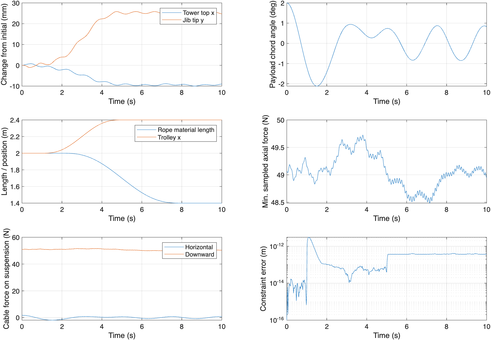
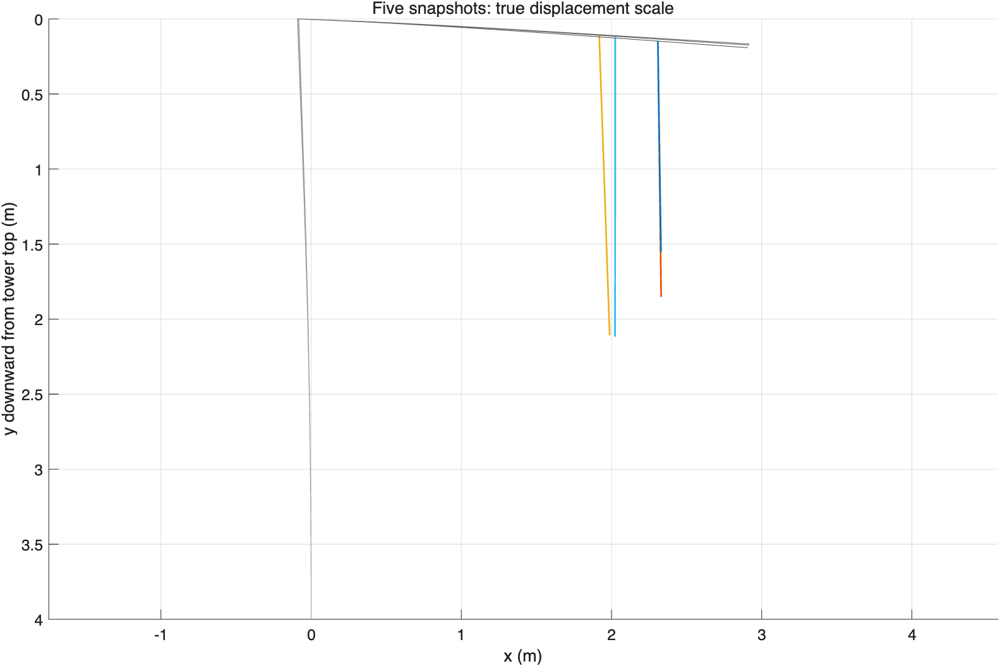

# 连续体塔身—起重臂与 ANCF 吊索耦合模型说明书

版本：2026-10-28。配套入口：`matlab/tower_crane_continuum_ancf.m`。

## 1. 建模目的与范围

依据用户提供的[连续体振动建模讨论](https://chatgpt.com/share/6ae145b7-76ac-83ee-8bb7-119855661e5d)，采用 Euler–Bernoulli 连续梁、假设模态法和 ANCF 吊索组成混合柔性多体模型。塔身和起重臂没有划分梁有限元：其空间积分直接对连续振型进行。吊索仍使用 ANCF 有限单元。

“塔座”在本版中解释为底部固支的塔身承载结构，地基端位移和转角为零；并未建立独立的弹性地基、底座转动或土体模型。塔身横向弯曲、臂架竖向弯曲与吊载摆动均在同一个竖直平面。塔顶与臂根刚接，塔顶横向位移和转角会共同带动臂架。未考虑回转、扭转、剪切变形、轴向压缩几何刚度、拉杆、平衡臂和配重。

本版支持固定材料长度 ANCF，以及给定收放绳轨迹的 ALE-ANCF。小车沿臂架的坐标由光滑轨迹规定，求解器计算执行该轨迹的广义驱动力；不包含电机动力学或最优控制。参数是实验室尺度演示值，不能直接用于真实塔吊的承载或安全评估。

## 2. 坐标、连续场与边界条件

全局 X 向右，Y 向下，原点为未变形塔顶。塔身轴坐标 z 从固定底座向上量，0≤z≤H；臂架轴坐标 ξ 从臂根向右量，0≤ξ≤B。分别取 nT、nJ 阶模态：

\[
w_T(z,t)=\sum_i\phi_i(z)\eta_i(t),\qquad
w_J(\xi,t)=\sum_j\psi_j(\xi)\zeta_j(t).
\]

记 a=φ(H)、b=φ′(H)，则塔顶横移 aη、顺时针向下的臂根转角为 −bη。在线性小变形运动学下，臂架中心线为

\[
r_J(\xi)=\begin{bmatrix}\xi+a\eta\\-\xi b\eta+\psi(\xi)\zeta\end{bmatrix}.
\]

塔身中心线为 [wT(z), H−z]ᵀ。臂架的整体平移和转动进入动能，绝非把塔身和臂架视为互不相关的独立振子。该线性运动学忽略转角平方项，不能用于结构的大转动；吊索中心线允许大位移、大转动。

使用均匀悬臂梁的精确未加载振型作为 Ritz 基函数：

\[
\phi_i(z)=\frac{\cosh(\beta_i z/H)-\cos(\beta_i z/H)-\sigma_i[\sinh(\beta_i z/H)-\sin(\beta_i z/H)]}{\text{同一表达式在 }z=H\text{ 的值}},
\quad \sigma_i=\frac{\cosh\beta_i+\cos\beta_i}{\sinh\beta_i+\sin\beta_i}.
\]

β 为 coshβ cosβ=−1 的正根，前四个为 1.875104、4.694091、7.854757、10.995541。臂架将 H 换为 B。归一化后端点振型值为 1，η、ζ 单位为 m。塔根满足 wT=wT′=0，臂根相对变形满足 wJ=wJ′=0。自由端的未加载条件用于构造基函数；实际连接载荷通过虚功进入弱式。有限阶截断不会逐点精确满足载荷作用下的全部自然边界条件，必须做模态截断检查。

连续梁无外载的强式为 μẅ+EIw''''=0；连接载荷可作为边界力或集中分布力加入。梁的质量与刚度来自

\[
T_T=\tfrac12\int_0^H\mu_T\dot w_T^2dz,\quad
T_J=\tfrac12\int_0^B\mu_J\dot r_J^T\dot r_Jd\xi,
\quad U_s=\tfrac12\int_0^H EI_T(w_T'')^2dz+\tfrac12\int_0^B EI_J(w_J'')^2d\xi.
\]

`setup.m` 用 32 点 Gauss 求积组装 Ms、Ks，Ms 包含塔身—臂架交叉项。结构重力势能为 −∫μJ g rJ,Y dξ；本近似内塔身自身重力为常数。阻尼按各未耦合梁的模态质量和刚度取 Cii=2ζ√(mi ki)，这是经验结构阻尼，并不意味着耦合后所有模态均具有同一阻尼比。

## 3. 小车运动与对流加速度

令结构坐标 qs=[η;ζ;x]，小车位置 rA=rJ(x)，质量 mT。记

\[
J_A=\frac{\partial r_A}{\partial q_s},\qquad
\dot r_A=J_A\dot q_s,\qquad \ddot r_A=J_A\ddot q_s+h_A.
\]

雅可比两行为 [a,0,1] 与 [−xb,ψ(x),−bη+ψ′(x)ζ]。对流加速度为

\[
h_A=\begin{bmatrix}0\\2[-b\dot\eta+\psi'(x)\dot\zeta]\dot x+\psi''(x)\zeta\dot x^2\end{bmatrix}.
\]

小车贡献质量 mT JAᵀJA，右端力 mT JAᵀ([0,g]ᵀ−hA)。忽略 hA 会漏掉移动载荷与结构振动的速度耦合。本实现将该表达式与方向有限差分独立比较。

## 4. ANCF 吊索与材料运动

每节点 eᵢ=[Xi,Yi,Xs,i,Ys,i]ᵀ，其中斜率对未伸长材料坐标 s 求导，不强制单位化。N 段单元共有 4(N+1) 个坐标。三次 Hermite 插值为

\[
r=N_e e_e,\quad N_e=[H_1I_2,\ell H_2I_2,H_3I_2,\ell H_4I_2],
\]

H1=1−3u²+2u³，H2=u−2u²+u³，H3=3u²−2u³，H4=−u²+u³。相邻单元共享位置和斜率。绳两端只约束位置，切线自由，表示无外加端弯矩的铰接。

为与工程中已验证的 ALE 单元一致，采用工程轴向应变和材料曲率度量：

\[
\epsilon=\|r_s\|-1,\qquad k_m=\frac{r_{s,X}r_{ss,Y}-r_{s,Y}r_{ss,X}}{r_s^Tr_s},\quad
U_c=\tfrac12\int(EA\epsilon^2+EI_c k_m^2)ds.
\]

弹性力 Qint=∂Uc/∂e 解析计算，每单元八点 Gauss 求积。本构与分享讨论中举例的 Green–Lagrange 应变及几何曲率能量形式不同；这是明确采用的另一种弹性绳本构，不应混用两套内力公式。工程应变对应的 EAε 是轴向本构力，不能代替包含弯曲剪力的完整端反力。小弯曲刚度用于柔索中心线描述，不含真实钢丝捻制的摩擦、迟滞及松绳接触。

材料网格采用 sᵢ(t)=(−1+i/N)L(t)，下端材料标签恒为 0。长度恒定时是标准 ANCF；收放绳时所有单元按比例移动，不做单元增删。固定 s 的材料速度与加速度为

\[
v_m=N\dot e+N_t e,\quad a_m=N\ddot e+2N_t\dot e+N_{tt}e.
\]

于是

\[
M_c=\int\rho A N^TNds,\qquad Q_{ALE}=\int\rho A N^T(2N_t\dot e+N_{tt}e)ds.
\]

绳方程右端是 Fg,c−Qint−QALE。该式由材料加速度的虚功得到；不把开放自由段直接当成封闭系统求普通拉格朗日方程。复用了原工程 `+aleancf/shape.m`、`geometry.m`、`element.m`；长度变化不能只改质量矩阵而省略材料输运项。

卷扬轨迹由外部理想执行器规定，自由域质量为 ρAL(t)。没有建立卷筒接触、进出边界张力及完整功率流审计，因此收放绳结果应视为规定材料运动条件下的机械响应模型；尚非包含卷扬机能耗的完整系统模型。

## 5. 完整位置级 DAE 与实现

保留独立吊物位置 rP=[XP,YP]ᵀ，总坐标为

\[
q=[\eta;\zeta;x;e;r_P],\qquad n=n_T+n_J+1+4(N+1)+2.
\]

默认 nT=nJ=2、N=3，共 23 个机械坐标。五个标量约束为

\[
\Phi(q,t)=\begin{bmatrix}e_{\rm top,pos}-r_A(q_s)\\e_{\rm bottom,pos}-r_P\\x-x_d(t)\end{bmatrix}=0,\qquad G=\Phi_q.
\]

四个是连接约束，第五个是规定小车轨迹。动力学写为

\[
M(q,t)\ddot q+G^T\lambda=f(q,\dot q,t),\qquad\Phi=0,
\]

其中质量矩阵分块为 diag(Ms+mT JAᵀJA, Mc, mP I2)，结构右端为 Fg,s−Ks qs−Cs q̇s+mT JAᵀ(gvec−hA)，绳右端见上节，吊物右端为 [0,mP g]ᵀ。

令 Φ̇=Gq̇−[0,0,0,0,ẋd]ᵀ。二阶约束右端 γ=[hA;0;0;ẍd]。每次 RHS 调用求解

\[
\begin{bmatrix}M&G^T\\G&0\end{bmatrix}
\begin{bmatrix}\ddot q\\\lambda\end{bmatrix}=
\begin{bmatrix}f\\\gamma-2\alpha\dot\Phi-\beta^2\Phi\end{bmatrix}.
\]

使用 α=β=10 s⁻¹ 的 Baumgarte 稳定化，并由 `ode15s` 积分 [q;q̇]。**实际算法是加速度级约束求解后积分 ODE，不是直接向 ode15s 输入位置级指数三 DAE。** 输出位置、速度约束残差和动力学线性方程残差，避免把小的线性求解残差误认为约束不漂移。

按上述符号约定，λ1:2 是吊索施加在吊点上的全局力，λ3:4 是吊索施加在吊物上的力；−λ5 是使小车坐标满足规定轨迹的驱动广义力（N）。默认 28 阶鞍点系统解出 23 个加速度与 5 个乘子。约束满秩、质量矩阵正定时该系统可逆。

## 6. 初值、输入与参数

初始 x=x0，所有速度为零。先求垂直静载下的结构静态变形，载荷包括臂架自重、小车、吊物及全绳自重；再以绳顶为起点构造有自重轴向伸长的垂直绳：

\[
Y(u)-Y_A=u+[m_Pgu+\rho Ag(L_0u-u^2/2)]/EA,\quad
Y_s=1+[m_Pg+\rho Ag(L_0-u)]/EA.
\]

u∈[0,L0]。二次场可由 Hermite 单元精确表示。theta0=0 时得到静平衡；默认把绳相对吊点旋转 2° 后释放，此时连接位置与初速度仍一致，但不再是静平衡。

小车与绳长均用 f(s)=10s³−15s⁴+6s⁵，s 在起止时刻外截断至 0/1，保证速度和加速度连续。

| 参数 | 默认值 | 含义 |
|---|---:|---|
| H、B | 4、3 m | 塔身高、臂长 |
| muTower、muJib | 12、8 kg/m | 等效线密度 |
| EITower、EIJib | 80000、30000 N·m² | 等效抗弯刚度 |
| nTower、nJib | 2、2 | 各部件截断模态数，支持 1–4 |
| zeta | 0.01 | 未耦合梁模态阻尼参数 |
| mT、mP | 20、5 kg | 小车、吊物质量 |
| rhoA | 0.1 kg/m | 绳未伸长参考线密度 |
| EA、EI | 20000 N、0.02 N·m² | 绳轴向、弯曲刚度 |
| nElem | 3 | 绳单元数 |
| x0→x1 | 2→2.4 m | 小车 1–5 s 移动 |
| L0→L1 | 2→1.4 m | 绳在 2–8 s 收短 |
| theta0 | 2° | 初始倾角 |
| tEnd、nOutput | 10 s、501 | 仿真区间、保存点数 |
| relTol、absTol | 2e−7、1e−9 | 自适应积分容差 |

`parameters.m` 为复用旧吊索接口继承了一些字段。旧 kB、cB、forceAmplitude 等集总支撑与水平驱动力字段不参与本模型的力方程；实际结构刚度、阻尼由连续梁参数决定，小车由 x 轨迹驱动。

## 7. 运行和输出

在项目根目录启动 MATLAB R2026a（实际验证环境），执行：

```matlab
addpath('matlab');
out = tower_crane_continuum_ancf;
test_continuum_ancf;
```

只需基础 MATLAB。完整验证包含多次加密仿真，可能需要数分钟；只查看默认算例时直接运行入口或加载已有 MAT 文件。运行入口生成本目录下的 `simulation.mat`、`history.csv`、`simulation.png` 和 `geometry.png`。测试生成 `validation.txt` 和 `frequencies_hz.csv`。图中结构响应减去了初始静态变形，而 CSV 保留绝对弹性位移。几何图是真实位移比例，微小振动肉眼可能不明显。

```matlab
% 固定索长、固定小车的自由振动
p=continuum.parameters();
p.L1=p.L0; p.x1=p.x0;
out=continuum.simulate(p);

% 纯静平衡保持
p.theta0=0;
out=continuum.simulate(p);

% 模态、绳网格加密
p=continuum.parameters();
p.nTower=3; p.nJib=3; p.nElem=6;
out=continuum.simulate(p);
continuum.plot_results(out,fullfile('report','continuum','refined'));
```

`out.z` 前 n 列为 q，后 n 列为 q̇，索引详见 out.c；`theta` 是吊点至吊物的弦线摆角；`topX` 为塔顶横移；`tipY` 包含臂根转动和臂架相对弯曲；`lambda` 为五个约束乘子。`axialForceMin` 为保存时刻各积分点的最小轴向本构力。事件检测到积分点应变不再为正则终止并报错，不能继续把受压梁解释成松弛绳。

## 8. 验证设计与解读

`test_continuum_ancf.m` 检查：

1. 总质量矩阵对称正定、五个约束独立、静平衡初始加速度接近零。
2. 连续积分得到的塔身孤立一阶频率与解析悬臂梁频率一致。
3. 小车速度和对流加速度与运动学方向有限差分一致。
4. 在静平衡处对约束拉格朗日力做数值切线，在 G 的零空间内解广义特征值问题；检查投影刚度对称与频率为正。
5. 固定索长、固定小车、零阻尼自由振动的机械能守恒及位置约束漂移。
6. 收放绳和小车运动工况的张力、约束和动力学残差。
7. 收紧时间容差、绳 3→6 单元、结构 2→3 模态的响应敏感性。

固有频率来自加载平衡点的受约束切线，而不是孤立塔身/吊臂频率的简单拼接。规定的小车坐标在该特征值分析中固定。

固定域能量测试不能验证开放域的卷扬功率流。有限点输出也不能保证高频张力峰值已捕获；需要增大 nOutput 并做采样检查。单一摆角的网格比较不代表局部曲率、反力、应力和高频响应收敛。本版未与实验、独立商业软件或真实塔吊参数标定结果对照。

## 9. 文件职责与扩展

| 文件（matlab/ 下） | 职责 |
|---|---|
| tower_crane_continuum_ancf.m | 默认仿真、保存结果 |
| +continuum/parameters.m | 参数与输入时间 |
| +continuum/modes.m | 连续悬臂梁振型与导数 |
| +continuum/setup.m | 连续梁能量积分、索引和阻尼 |
| +continuum/point.m | 吊点运动学及对流加速度 |
| +continuum/trajectory.m | 小车轨迹及导数 |
| +continuum/assemble.m | 总质量、力、约束、能量与输出 |
| +continuum/rhs.m | 鞍点系统与稳定化 |
| +continuum/initial_state.m | 静态载荷一致初值和摆动扰动 |
| +continuum/simulate.m | 积分、松绳事件与诊断 |
| +continuum/plot_results.m | 时程与几何快照 |
| test_continuum_ancf.m | 验证与敏感性比较 |

若需要弹性塔座，应增加基础平移/转动坐标和对应质量、刚度、阻尼，并修改塔身及臂架的绝对运动学；不能仅修改一个 EI 参数。研究真实桁架需识别等效 EI、μ、连接与支撑条件。进一步进行最优控制时可优化 x(t)、L(t) 的轨迹系数，或移除第五约束、加入小车驱动力方程；卷扬动力学需单独补充材料通量与执行器模型。

## 10. 本机算例结果

默认 10 s 工况已在 MATLAB R2026a 完整运行。最大弦线摆角为 2.11684°，采样最小轴向力为 48.4843 N，最大位置约束误差为 3.070×10⁻¹² m。塔顶绝对横移约为 −0.09216 至 −0.08141 m，臂端绝对竖向位移约为 0.16588 至 0.19303 m；这些量包括重力静挠度，并非全是振动幅值。

固定域无阻尼测试（2 s）机械能漂移为 8.313×10⁻¹² J，位置约束误差为 4.485×10⁻¹⁴ m。固定小车、初始长度下的前六阶耦合频率为 0.351881、1.066949、2.768382、5.612007、7.551480、11.209885 Hz。具体容差、时间区间和精度敏感性见同目录 `validation.txt`，不要将该数值精度解释为实物模型精度。





### 精度敏感性实测（0–6 s）

| 改变项目 | 弦线摆角最大差异 |
|---|---:|
| 时间相对容差 2e−7→2e−8，同时收紧绝对容差和最大步长 | 1.699×10⁻¹¹ rad |
| 绳单元 3→6 | 4.900×10⁻⁸ rad |
| 每根梁模态 2→3（保持六段绳） | 1.614×10⁻⁴ rad |

梁模态 2→3 时，塔顶横移最大差异为 1.740 mm，臂端竖向位移最大差异为 9.365 mm。**这说明结构挠度对截断模态仍有可见敏感性，不能宣称默认两阶模型的结构位移已经收敛。** 研究结构挠度时应至少继续比较三阶与四阶，必要时扩展振型数或采用适合连接载荷的 Ritz 基。当前默认两阶模型用于可运行的耦合动力学演示。全部自动检查通过，仅代表本说明书所列不变量与误差门限满足，不构成实验验证。
