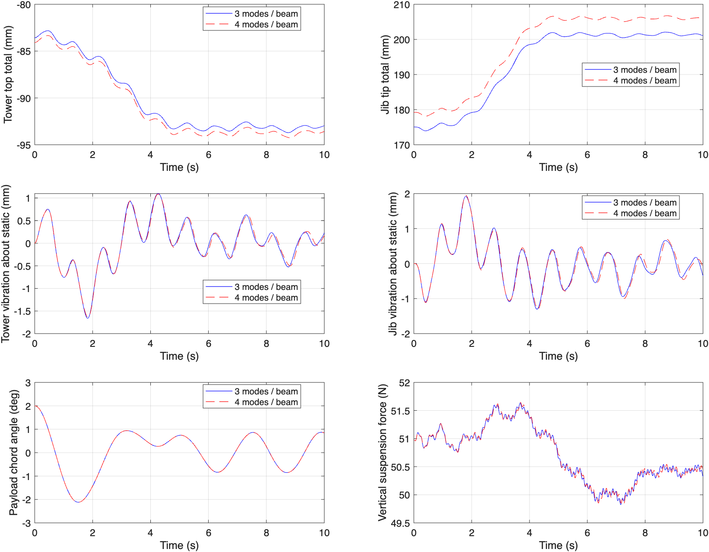
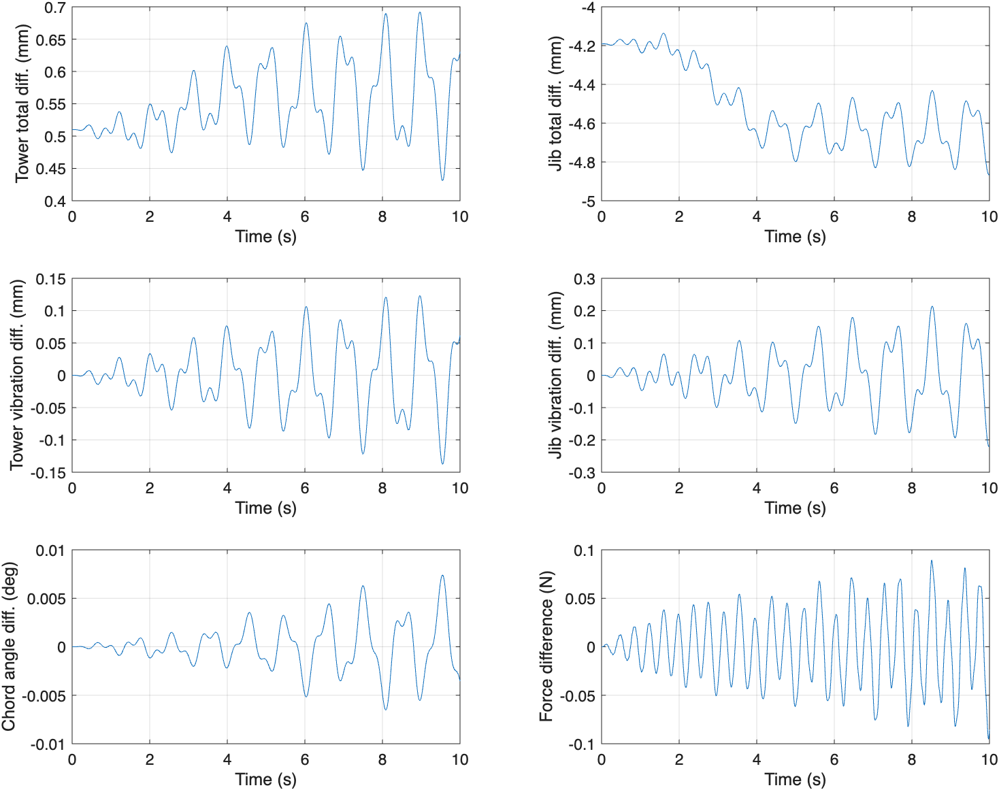

# 三阶与四阶梁模态的收敛性分析

本分析针对当前二维模型。保持原运动学、材料参数、吊索网格和驱动轨迹不变，同时将塔身与吊臂的模态数从三阶增加到四阶。这里的“三阶”指每根梁保留前三个模态，而非只保留第三个模态。

## 1. 判定方法

不能把“相邻两次计算很接近”直接等同于收敛。因此采用两种检查：

1. 静态响应与同一线性连续梁模型的解析解比较，获得真实的模态截断误差。
2. 在完整 0–10 s 运动过程中比较三阶、四阶时程，分别查看总位移、相对初始位移、相对瞬时静态平衡的振动分量、摆角与连接反力。

如使用 1% 作为暂定工程筛选门限，这只是本次分析采用的精度目标，不是通用规范。即使三阶与四阶差异小于 1%，也不能证明已接近无限阶极限。静态解析误差是更强的判据。

## 2. 统一计算条件

- 吊索：六个 ALE-ANCF 单元，两组保持完全相同。
- 塔身与吊臂：分别同时保留 3 或 4 个未加载悬臂梁模态。
- 仿真区间：0–10 s，包含小车 1–5 s 运动、2–8 s 收绳及最后 2 s 的停止后响应。
- 小车：2→2.4 m；未伸长绳长：2→1.4 m；初始绳倾角：2°。
- ode15s：RelTol=2e−8，AbsTol=1e−10，MaxStep=0.01 s。
- 每组保存 2001 点，输出间隔 0.005 s。
- 只改变模态数；每一组均由其自身的静载平衡构造初值，再施加相同的绳倾角扰动。

“振动分量”定义为动态位移减去该截断模型在同一时刻小车位置、绳长下的垂直静载平衡位移。它用于分离静态柔度差异与振动响应差异，不表示运动中的结构实际处于静平衡。

## 3. 独立的静态解析基准

在竖直绳、无水平载荷的静态条件下，令 w=μJ g 为臂架均布自重、P=(mT+mP+ρAL)g 为吊点集中重量，x 为小车位置。传递到塔顶的力矩大小为

M0 = w B²/2 + Px。

按当前模型坐标与符号，塔顶横移、塔顶斜率和臂端总竖向位移为

- uT = −M0 H²/(2 EIT)
- wT′(H) = −M0 H/EIT
- yJ = B M0 H/EIT + w B⁴/(8 EIJ) + P x²(3B−x)/(6 EIJ)

第一项 B M0 H/EIT 是塔顶转角传递给臂端的位移，另外两项是臂架自身弯曲。该基准与当前代码具有相同的小变形、刚接、均匀梁、塔身不计轴向变形等假设，比较的是离散精度，不是实物建模精度。

初始位置 x=2 m、L=2 m 时，M0=847.584 N·m，解析塔顶横移为 −84.7584 mm，塔顶斜率为 −0.0423792 rad，臂端总下挠约为 192.08 mm。

| 每根梁的模态数 | 塔顶横移 / mm | 塔顶横移相对解析误差 | 臂端总下挠 / mm | 臂端总下挠相对解析误差 |
|---|---:|---:|---:|---:|
| 1 | −75.500 | 10.923% | 144.16 | 24.947% |
| 2 | −82.177 | 3.045% | 166.95 | 13.084% |
| 3 | −83.575 | 1.396% | 175.05 | 8.863% |
| 4 | −84.085 | 0.794% | 179.25 | 6.681% |

四阶的臂端总挠度仍比解析值小约 12.83 mm。因此无论三阶、四阶动态摆角是否接近，都不能宣称结构位移已整体收敛。

## 4. 静态误差来源

误差主要来自塔顶转角的模态截断，而非臂架自身弯曲项。

- 精确塔顶转角对臂端位移的贡献：127.1376 mm。
- 三阶塔身的对应贡献：110.1150 mm，低估 17.0226 mm。
- 四阶塔身的对应贡献：114.3216 mm，低估 12.8160 mm。

四阶臂端总误差约 12.834 mm，其中约 12.816 mm 来自塔顶转角传递。这也解释了为何塔顶横移看起来已经比较准确，臂端总挠度仍有明显误差：二者依赖振型的不同量，后者强烈依赖端部斜率。

当前使用未加载悬臂梁的固有振型作为 Ritz 基。该基可用于弱式离散，但有限个振型对端部力矩引起的静态转角逼近较慢；所有这些基函数均满足无载自由端弯矩条件，而受端矩梁的静态挠曲线是二次函数。不能将这解释成“连续梁方法不能用”，也不能只通过收紧时间积分容差消除空间截断误差。

优先改进方向是在塔身基底中加入端弯矩静态修正形状（与 z² 成比例），或采用满足固定端必要边界条件的合适 Ritz 基，并重新一致组装质量、刚度和耦合项。加入基函数后需要检查线性独立性和矩阵条件数，再重新做静态与动态验证。

## 5. 输出文件与复现

在项目根目录的 MATLAB 中运行：

```matlab
addpath('matlab');
result=analyze_continuum_modal_convergence;
```

- `static_convergence.csv`：一至四阶静态结果及解析误差。
- `static_rotation.csv`：塔顶转角对臂端静挠度贡献的独立计算。
- `modes_3.mat`、`modes_4.mat`：完整状态、反力和诊断。
- `dynamic_comparison.csv`：最大差、RMS 差、四阶参考峰值及归一化差异。
- `residual_8_to_10s.csv`：驱动停止后 8–10 s 的响应对比。
- `response_comparison.png`、`response_differences.png`：时程叠加和差值。

相对峰值误差定义为 max|y3−y4| / max|y4|，L2 相对误差为 ||y3−y4||₂ / ||y4||₂。接近零的量不宜只看百分比，应同时查看绝对误差。

0.005 s 的输出间隔仍不足以保证高频绳轴向振动和瞬时反力峰值已采样收敛；本次反力比较只针对保存时刻。本次也未再次加密吊索网格，结论不能代替绳网格、时间积分和采样的独立收敛研究。

## 6. 完整动态对比结果

两组均成功完成 10 s 仿真。三阶、四阶最大位置约束误差分别为 6.071×10⁻¹³ m、5.835×10⁻¹³ m，采样最小轴向力分别为 48.45291 N、48.42983 N。以下相对差异以四阶时程的最大绝对值为分母；它是两个离散模型之间的差异，不是相对真实解的误差。

| 量 | 最大绝对差异 | RMS 差异 | 相对峰值差异 | L2 相对差异 |
|---|---:|---:|---:|---:|
| 塔顶总横移 | 0.69204 mm | 0.55379 mm | 0.734% | 0.609% |
| 臂端总竖向位移 | 4.86714 mm | 4.51374 mm | 2.354% | 2.276% |
| 塔顶相对初始位移 | 0.18196 mm | 0.06941 mm | 1.789% | 0.894% |
| 臂端相对初始位移 | 0.67621 mm | 0.37820 mm | 2.459% | 1.746% |
| 塔顶振动分量 | 0.13777 mm | 0.05063 mm | 8.397% | 9.554% |
| 臂端振动分量 | 0.22112 mm | 0.08304 mm | 11.348% | 12.915% |
| 吊载弦线摆角 | 0.00740 ° | 0.00235 ° | 0.350% | 0.261% |
| 吊点水平反力 | 0.00547 N | 0.00196 N | 0.292% | 0.248% |
| 吊点竖向反力 | 0.09527 N | 0.03696 N | 0.184% | 0.073% |
| 小车轨迹驱动广义力 | 0.64450 N | 0.39260 N | 2.868% | 2.119% |

“相对初始位移”包含小车移动引起的静载挠度变化，不能直接称为纯振动。本报告的“振动分量”则减去了每一时刻、每一阶次模型自己的垂直静载平衡值。振动分量的相对差异包含幅值和相位的共同影响，不能直接说成“振幅误差为 11.3%”。





### 停止运动后的 8–10 s

四阶塔顶振动分量峰值约为 0.502 mm，三阶为 0.526 mm；但同一时刻的两组响应最大差异为 0.138 mm，相对四阶该区间峰值约为 27.5%。四阶臂端振动分量峰值约为 0.692 mm，三阶为 0.662 mm；同一时刻最大差异为 0.221 mm，约占四阶该区间峰值的 31.9%。

因此，即使两条曲线看上去接近、峰值大小也相近，残余结构振动的相位和时程仍对阶数敏感。这一点对后续以残余结构振动为目标的优化尤其重要。这里仅检查 2 s 的停止后窗口，不代表全部长期残余振动峰值。

## 7. 结论与下一步

**三阶与四阶尚未实现所有研究量的统一收敛。** 应按输出量分别表述：

- 吊载摆角：本工况三阶与四阶的最大差异约 0.00740°、相对峰值差异约 0.350%，说明对这一次模态加密已较不敏感；不能据此证明对所有工况或无限阶极限收敛。
- 塔顶总横移：两组差异约 0.734%；初始静态四阶相对解析误差约 0.794%，在该静态量上接近暂定 1% 目标。但不能将结论扩展到塔顶转角或纯振动分量。
- 臂端总位移：动态两组差异约 2.354%，四阶初始静态相对解析误差仍为 6.681%，未达到 1% 目标。
- 结构振动：相对瞬时静载平衡的振动时程差异约 8.4%（塔顶）、11.3%（臂端），停止后区间相对差异更明显。当前不宜宣称结构残余振动已经模态收敛。
- 连接反力：保存时刻的吊点水平、竖向反力差异分别约 0.292%、0.184%，但高频采样尚未独立加密，不作瞬时反力峰值已收敛的结论。小车驱动广义力差异约 2.868%。

优先处理塔身端矩造成的静态转角截断误差，再比较改进后的静态解与动态响应。不要将三阶或四阶直接设为“已验证的充分阶数”，也无需因此放弃连续梁建模框架。当前模型参数和动力学方程未作修改，本次新增的是分析脚本和结果文件。

本次两组使用相同且较严格的积分容差，但未额外运行四阶模型的独立时间容差加密。所有数值差异首先应理解为本次计算设置下观察到的敏感性。静态解析误差不受时间积分误差影响，因此“臂端静挠度尚未收敛”的结论具有独立依据。
