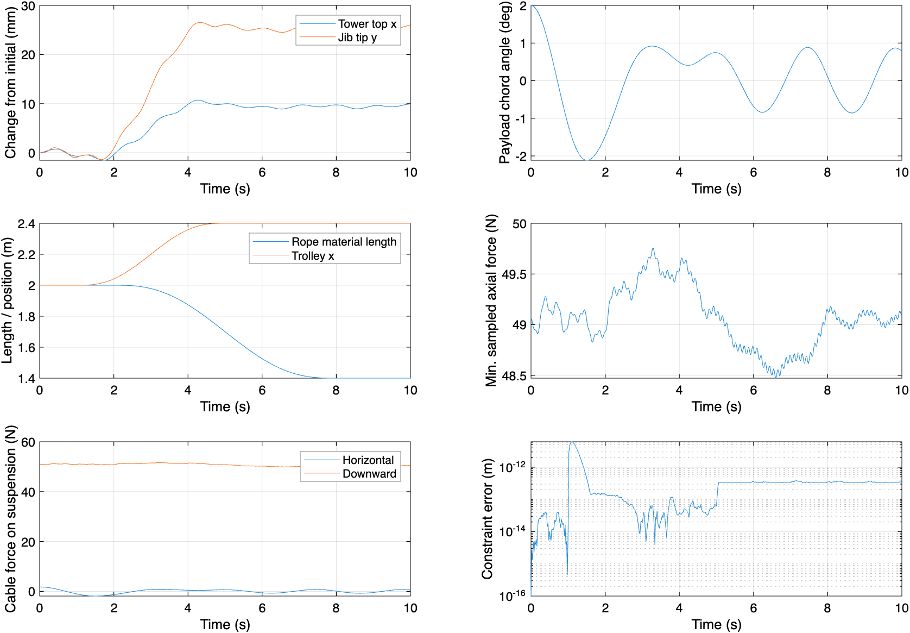
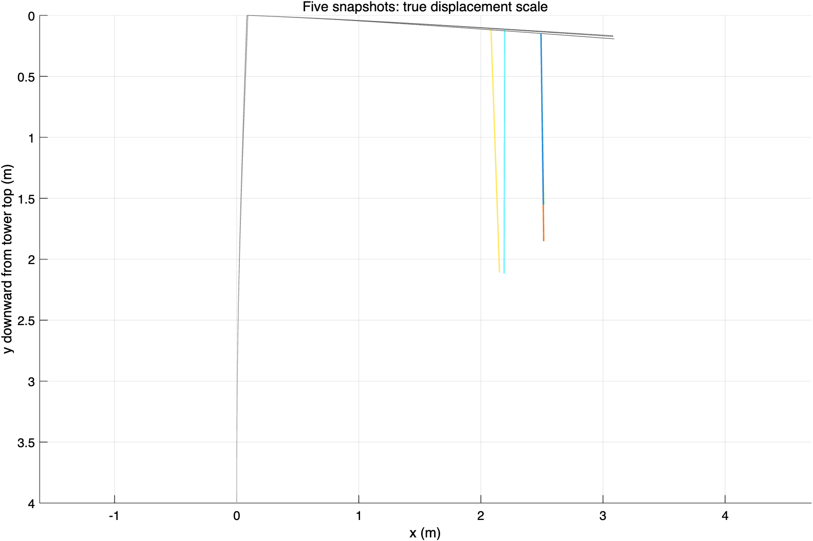

# 連続体タワー・ジブと ANCF 吊りロープの連成モデル説明書

版：2026-11-02。実行ファイル：`matlab/tower_crane_continuum_ancf.m`。

2026-11-02 修正：X を右向き、Y を下向き、タワー座標 z を上向きとすると、ジブ根元の回転角は +wT′(H) となる。本版では運動学、慣性、重力、出力の符号を統一して修正した。旧結果は legacy_before_sign_fix/、再検証は structure_validation_corrected/ に保存する。

## 1. モデルの目的と適用範囲

ユーザーが提示した[連続体振動のモデル化に関する議論](https://chatgpt.com/share/6ae145b7-76ac-83ee-8bb7-119855661e5d)に基づき、Euler-Bernoulli 連続はり、仮定モード法、ANCF 吊りロープを組み合わせた柔軟マルチボディモデルを構築した。タワーとジブははり有限要素に分割せず、連続モード関数を直接積分する。ロープには ANCF 有限要素を使用する。

本版では「塔座」を、下端が固定されたタワー支持構造として扱い、基礎端の変位と回転角をゼロとする。独立した弾性基礎、台座の回転、地盤モデルは含まない。タワーの横曲げ、ジブの鉛直曲げ、吊り荷の振れは同一鉛直平面内にある。タワー頂部とジブ根元は剛接合とし、頂部の横変位と回転がジブを動かす。旋回、ねじり、せん断変形、軸圧縮による幾何剛性、タイロッド、カウンタージブ、カウンターウェイトは考慮しない。

固定材料長の ANCF と、巻上げ・繰出し軌道を指定する ALE-ANCF に対応する。ジブ上のトロリ座標を滑らかな軌道で規定し、その実現に必要な一般化駆動力を計算する。モータの動力学と最適制御は含まない。パラメータは実験室規模の例示値であり、実機の耐荷重や安全性評価に直接使用するものではない。

## 2. 座標系、連続変位場、境界条件

全体座標 X は右向き、Y は下向き、原点は未変形時のタワー頂部とする。タワー軸座標 z は固定基礎から上向きに測り、0≤z≤H とする。ジブ軸座標 ξ は根元から右向きに測り、0≤ξ≤B とする。タワーとジブにそれぞれ nT、nJ 個のモードを用いる。

\[
w_T(z,t)=\sum_i\phi_i(z)\eta_i(t),\qquad
w_J(\xi,t)=\sum_j\psi_j(\xi)\zeta_j(t).
\]

a=φ(H)、b=φ′(H) とおくと、タワー頂部の横変位は aη、ジブ根元の下向き時計回りの回転角は bη となる。線形微小変形の運動学におけるジブ中心線は次式で表す。

\[
r_J(\xi)=\begin{bmatrix}\xi+a\eta\\\xi b\eta+\psi(\xi)\zeta\end{bmatrix}.
\]

タワー中心線は [wT(z), H−z]ᵀ である。ジブ全体の並進と回転を運動エネルギーに含めるため、タワーとジブは独立した振動子ではない。この線形運動学では回転角の二次項を無視するので、構造の大回転には適用できない。一方、ロープ中心線の大変位と大回転は表現できる。

一様片持ちはりの無負荷時の厳密な固有モードを Ritz 基底として使用する。

\[
\phi_i(z)=\frac{\cosh(\beta_i z/H)-\cos(\beta_i z/H)-\sigma_i[\sinh(\beta_i z/H)-\sin(\beta_i z/H)]}{\text{同じ式の }z=H\text{ における値}},
\quad \sigma_i=\frac{\cosh\beta_i+\cos\beta_i}{\sinh\beta_i+\sin\beta_i}.
\]

β は coshβ cosβ=−1 の正根であり、最初の四つは 1.875104、4.694091、7.854757、10.995541 である。ジブでは H を B に置き換える。先端値を 1 に正規化し、η、ζ の単位を m とする。タワー基部では wT=wT′=0、ジブ根元の相対変形では wJ=wJ′=0 を満たす。無負荷自由端条件は基底の構成に用い、実際の接続荷重は仮想仕事を通じて弱形式に導入する。有限モードの打切りでは、荷重作用時のすべての自然境界条件を点ごとに厳密には満たさないため、打切り次数の検討が必要である。

外力のない連続はりの強形式は μẅ+EIw''''=0 であり、接続荷重を境界力または集中分布荷重として加える。質量と剛性は次のエネルギーから得る。

\[
T_T=\tfrac12\int_0^H\mu_T\dot w_T^2dz,\quad
T_J=\tfrac12\int_0^B\mu_J\dot r_J^T\dot r_Jd\xi,
\quad U_s=\tfrac12\int_0^H EI_T(w_T'')^2dz+\tfrac12\int_0^B EI_J(w_J'')^2d\xi.
\]

`setup.m` では max(32,4nT,4nJ) 点 Gauss 積分で Ms、Ks を組み立てる。Ms にはタワーとジブの交差項を含む。構造の重力ポテンシャルは −∫μJ g rJ,Y dξ であり、この近似ではタワー自身の重力ポテンシャルは定数となる。減衰は非連成はりのモード質量・剛性を用いて Cii=2ζ√(mi ki) とする。これは経験的な構造減衰であり、連成後の全モードが同じ減衰比を持つという意味ではない。

## 3. トロリの運動と対流加速度

構造座標を qs=[η;ζ;x]、トロリ位置を rA=rJ(x)、質量を mT とする。

\[
J_A=\frac{\partial r_A}{\partial q_s},\qquad
\dot r_A=J_A\dot q_s,\qquad \ddot r_A=J_A\ddot q_s+h_A.
\]

ヤコビ行列の二つの行は [a,0,1] と [xb,ψ(x),bη+ψ′(x)ζ] である。対流加速度は次式となる。

\[
h_A=\begin{bmatrix}0\\2[b\dot\eta+\psi'(x)\dot\zeta]\dot x+\psi''(x)\zeta\dot x^2\end{bmatrix}.
\]

トロリの質量への寄与は mT JAᵀJA、右辺力への寄与は mT JAᵀ([0,g]ᵀ−hA) である。hA を無視すると、移動荷重と構造振動の速度連成項が欠落する。実装ではこの式を方向有限差分と独立に比較する。

## 4. ANCF ロープと材料運動

各節点の座標は eᵢ=[Xi,Yi,Xs,i,Ys,i]ᵀ であり、勾配は未伸長材料座標 s に関する位置の微分である。勾配を単位ベクトルに強制しない。N 要素では 4(N+1) 個の座標を持つ。三次 Hermite 補間を用いる。

\[
r=N_e e_e,\quad N_e=[H_1I_2,\ell H_2I_2,H_3I_2,\ell H_4I_2],
\]

H1=1−3u²+2u³、H2=u−2u²+u³、H3=3u²−2u³、H4=−u²+u³ である。隣接要素は位置と勾配を共有する。両端では位置のみを拘束し、接線方向を自由とするため、外部端モーメントのないピン接合を表す。

既存プロジェクトで検証済みの ALE 要素と整合させるため、公称軸ひずみと材料曲率尺度を採用する。

\[
\epsilon=\|r_s\|-1,\qquad k_m=\frac{r_{s,X}r_{ss,Y}-r_{s,Y}r_{ss,X}}{r_s^Tr_s},\quad
U_c=\tfrac12\int(EA\epsilon^2+EI_c k_m^2)ds.
\]

弾性内力 Qint=∂Uc/∂e は解析的に計算し、各要素を 8 点 Gauss 積分する。この構成則は、共有された議論で例示された Green-Lagrange ひずみと幾何曲率のエネルギー形式とは異なる。明示的に選択した別の弾性ロープ構成則であり、両者の内力式を混用してはならない。EAε は軸方向の構成則による力であり、曲げせん断力も含む完全な端部反力ではない。小さな曲げ剛性を用いてロープ中心線を記述するが、実際のより線の摩擦、履歴、たるみ時の接触は含まない。

材料格子を sᵢ(t)=(−1+i/N)L(t) とし、下端の材料ラベルを常に 0 とする。長さ一定時は標準 ANCF となる。巻上げ・繰出し時には全要素を比例移動させ、要素の追加・削除は行わない。固定した s における材料速度と加速度は次式である。

\[
v_m=N\dot e+N_t e,\quad a_m=N\ddot e+2N_t\dot e+N_{tt}e.
\]

したがって、質量行列と ALE 慣性項は次式となる。

\[
M_c=\int\rho A N^TNds,\qquad Q_{ALE}=\int\rho A N^T(2N_t\dot e+N_{tt}e)ds.
\]

ロープ方程式の右辺は Fg,c−Qint−QALE である。材料加速度の仮想仕事から導き、開放された自由ロープ領域を閉鎖系として通常の Lagrange 方程式に直接代入しない。既存の `+aleancf/shape.m`、`geometry.m`、`element.m` を再利用する。長さ変更時に質量行列だけを変更し、材料輸送項を省略してはならない。

巻上げ軌道は外部の理想アクチュエータによって規定し、自由領域の質量は ρAL(t) となる。ドラム接触、流入・流出境界の張力、完全なパワーフローの収支はモデル化していない。そのため、巻上げ結果は規定された材料運動の下での力学応答であり、巻上げ機の消費エネルギーまで含む完全な系ではない。

## 5. 位置レベル DAE と数値実装

吊り荷の独立位置 rP=[XP,YP]ᵀ を保持し、全座標を次のように定める。

\[
q=[\eta;\zeta;x;e;r_P],\qquad n=n_T+n_J+1+4(N+1)+2.
\]

既定値 nT=nJ=2、N=3 では機械座標は 23 個となる。五つのスカラー拘束は次式である。

\[
\Phi(q,t)=\begin{bmatrix}e_{\rm top,pos}-r_A(q_s)\\e_{\rm bottom,pos}-r_P\\x-x_d(t)\end{bmatrix}=0,\qquad G=\Phi_q.
\]

四つが接続拘束、五つ目がトロリの規定軌道である。運動方程式は次式となる。

\[
M(q,t)\ddot q+G^T\lambda=f(q,\dot q,t),\qquad\Phi=0,
\]

質量行列は diag(Ms+mT JAᵀJA, Mc, mP I2) のブロック構造である。構造の右辺は Fg,s−Ks qs−Cs q̇s+mT JAᵀ(gvec−hA)、ロープの右辺は前節の式、吊り荷の右辺は [0,mP g]ᵀ である。

Φ̇=Gq̇−[0,0,0,0,ẋd]ᵀ とおく。二階拘束の右辺は γ=[hA;0;0;ẍd] である。RHS の評価ごとに次の鞍点系を解く。

\[
\begin{bmatrix}M&G^T\\G&0\end{bmatrix}
\begin{bmatrix}\ddot q\\\lambda\end{bmatrix}=
\begin{bmatrix}f\\\gamma-2\alpha\dot\Phi-\beta^2\Phi\end{bmatrix}.
\]

α=β=10 s⁻¹ の Baumgarte 安定化を用い、`ode15s` で [q;q̇] を積分する。**実際のアルゴリズムは加速度レベルの拘束を解いた後に ODE を積分するものであり、位置レベルの指数 3 DAE を ode15s に直接入力するものではない。** 位置・速度拘束の残差と動力学線形方程式の残差を出力する。線形求解残差が小さいことだけでは、拘束ドリフトが小さいとは判断できない。

この符号規約では、λ1:2 はロープが吊点に及ぼす全体座標系の力、λ3:4 はロープが吊り荷に及ぼす力である。−λ5 はトロリ座標を規定軌道に追従させる一般化駆動力（N）となる。既定の 28 次鞍点系から 23 個の加速度と 5 個の乗数を求める。拘束が独立で質量行列が正定値なら、この系は可逆である。

## 6. 初期値、入力、パラメータ

初期位置を x=x0、全速度をゼロとする。まず、ジブ自重、トロリ、吊り荷、ロープ全体の自重を含む鉛直静荷重下の構造変形を求める。その後、吊点から自重による軸伸びを含む鉛直ロープを構成する。

\[
Y(u)-Y_A=u+[m_Pgu+\rho Ag(L_0u-u^2/2)]/EA,\quad
Y_s=1+[m_Pg+\rho Ag(L_0-u)]/EA.
\]

u∈[0,L0] である。この二次場は Hermite 要素で厳密に表現できる。theta0=0 なら静的平衡となる。既定ではロープを吊点まわりに 2° 傾けて解放する。このとき接続位置と初速度の整合性は保たれるが、静的平衡ではない。

トロリ位置とロープ長には f(s)=10s³−15s⁴+6s⁵ を使用する。開始前と終了後で s を 0、1 に制限し、速度と加速度の連続性を確保する。

| パラメータ | 既定値 | 意味 |
|---|---:|---|
| H、B | 4、3 m | タワー高さ、ジブ長さ |
| muTower、muJib | 12、8 kg/m | 等価線密度 |
| EITower、EIJib | 80000、30000 N·m² | 等価曲げ剛性 |
| nTower、nJib | 2、2 | 各はりの採用モード数、1–16 に対応 |
| zeta | 0.01 | 非連成はりのモード減衰パラメータ |
| mT、mP | 20、5 kg | トロリ、吊り荷の質量 |
| rhoA | 0.1 kg/m | 未伸長ロープの基準線密度 |
| EA、EI | 20000 N、0.02 N·m² | ロープの軸・曲げ剛性 |
| nElem | 3 | ロープ要素数 |
| x0→x1 | 2→2.4 m | トロリは 1–5 s に移動 |
| L0→L1 | 2→1.4 m | ロープは 2–8 s に短縮 |
| theta0 | 2° | 初期傾斜角 |
| tEnd、nOutput | 10 s、501 | 解析時間、保存点数 |
| relTol、absTol | 2e−7、1e−9 | 適応時間積分の許容誤差 |

`parameters.m` は既存ロープのインターフェースを再利用するため、一部の旧フィールドを継承する。kB、cB、forceAmplitude などの集中支持・水平駆動力フィールドは、本モデルの力の式には使用しない。構造の剛性と減衰は連続はりのパラメータから決まり、トロリは x 軌道によって駆動される。

## 7. 実行手順と出力

プロジェクトのルートで MATLAB R2026a（検証環境）を起動し、次を実行する。

```matlab
addpath('matlab');
out = tower_crane_continuum_ancf;
test_continuum_ancf;
```

基本 MATLAB のみを使用する。全検証では複数の細分化解析を行うため、数分かかる場合がある。既定例のみを確認する場合は実行ファイルを呼ぶか、保存済み MAT ファイルを読み込む。結果は `report/continuum/` 内の `simulation.mat`、`history.csv`、`simulation.png`、`geometry.png` に保存する。検証は `structure_validation_corrected/regression/` 内に `validation.txt` と `frequencies_hz.csv` を生成する。時刻歴図では構造の初期静的変形を差し引き、CSV には絶対弾性変位を保存する。形状図は実変位スケールであり、小振動が目立たない場合がある。

```matlab
% ロープ長とトロリを固定した自由振動
p=continuum.parameters();
p.L1=p.L0; p.x1=p.x0;
out=continuum.simulate(p);

% 静的平衡の保持
p.theta0=0;
out=continuum.simulate(p);

% モード数とロープ要素数の増加
p=continuum.parameters();
p.nTower=3; p.nJib=3; p.nElem=6;
out=continuum.simulate(p);
continuum.plot_results(out,fullfile('report','continuum','refined'));
```

`out.z` の前半 n 列が q、後半 n 列が q̇ であり、添字は out.c を参照する。`theta` は吊点から吊り荷への弦の振れ角、`topX` はタワー頂部の横変位、`tipY` はジブ根元の回転とジブ相対曲げを含む先端変位、`lambda` は五つの拘束乗数である。`axialForceMin` は保存時刻における全積分点の最小軸力である。積分点のひずみが正でなくなるとイベント処理で停止し、エラーを返す。圧縮されたはりの結果を、たるんだロープとして解釈してはならない。

## 8. 検証項目と結果の解釈

`test_continuum_ancf.m` で次を確認する。

1. 全質量行列の対称正定値性、五つの拘束の独立性、静的平衡で初期加速度がほぼゼロとなること。
2. 連続積分で得たタワー単体の一次固有振動数と片持ちはり解析解の一致。
3. トロリ速度・対流加速度と運動学の方向有限差分との一致。
4. 静的平衡で拘束 Lagrange 力の数値接線を求め、G の零空間で一般化固有値問題を解くこと。投影剛性の対称性と固有振動数の正値性。
5. ロープ長・トロリ位置固定、減衰ゼロの自由振動における力学的エネルギー保存と位置拘束ドリフト。
6. 巻上げとトロリ移動を伴う条件での張力、拘束、動力学残差。
7. 時間許容誤差の厳格化、ロープ 3→6 要素、構造 2→3 モードに対する応答感度。

固有振動数は荷重下平衡点の拘束付き接線から求めるものであり、タワー単体とジブ単体の振動数を単に並べたものではない。この固有値解析では規定トロリ座標を固定する。

固定領域のエネルギー試験では、開放領域の巻上げパワーフローを検証できない。また、有限個の出力点だけでは高周波張力ピークの捕捉を保証できないため、nOutput を増やしてサンプリングを検討する必要がある。一つの振れ角に関する格子比較だけでは、局所曲率、反力、応力、高周波応答の収束は示せない。本版は実験、独立した商用解析ソフト、実機パラメータ同定結果との比較を行っていない。

## 9. ファイル構成と拡張

| ファイル（matlab/ 内） | 役割 |
|---|---|
| tower_crane_continuum_ancf.m | 既定解析と結果保存 |
| +continuum/parameters.m | パラメータ、入力時刻 |
| +continuum/modes.m | 片持ちはりの連続モードと導関数 |
| +continuum/setup.m | はりのエネルギー積分、添字、減衰 |
| +continuum/point.m | 吊点の運動学と対流加速度 |
| +continuum/trajectory.m | トロリ軌道と導関数 |
| +continuum/assemble.m | 質量、力、拘束、エネルギー、出力 |
| +continuum/rhs.m | 鞍点系と安定化 |
| +continuum/initial_state.m | 静荷重と整合する初期値、振れの摂動 |
| +continuum/simulate.m | 積分、たるみイベント、診断 |
| +continuum/plot_results.m | 時刻歴と形状スナップショット |
| test_continuum_ancf.m | 検証と感度比較 |

弾性台座が必要な場合は、基礎の並進・回転座標と対応する質量、剛性、減衰を追加し、タワーおよびジブの絶対運動学を変更する必要がある。EI の変更だけでは表現できない。実際のトラス構造では等価 EI、μ、接合・支持条件を同定する。最適制御へ拡張する場合は x(t)、L(t) の軌道係数を最適化するか、第五拘束を取り除いてトロリ駆動力方程式を追加する。巻上げ動力学には材料流束とアクチュエータモデルを別途導入する必要がある。

## 10. 符号修正後の結果と再検証

2026-11-02 にタワー頂部とジブ根元の回転角の符号を修正し、すべての解析を再実行した。既定の 10 s 条件で最大弦振れ角は 2.116461°、保存時刻の最小軸力は 48.470858 N、最大位置拘束誤差は 6.199e-12 m である。タワー頂部の絶対横変位は 0.08063531～0.09289124 m、ジブ先端鉛直変位は 0.16554471～0.19346681 m であり、静的たわみを含む。

剛接部の接線直交性、静的平衡、質量行列、運動学、エネルギー、時間・格子の回帰検証に合格した。全記録は structure_validation_corrected/regression/validation.txt に保存した。構造モード数 4、6、8、12 を比較し、8→12 モードでは設定した判定基準を 6/8 項目が満たした。各量の誤差と閾値は structure_validation_corrected/verification_zh.md を参照する。

独立静力学解との比較では、16 モードのタワー頂部変位誤差は約 0.050%、頂部回転角誤差は約 2.532%、ジブ先端総たわみ誤差は約 1.63–1.68% であった。符号修正の検証には合格したが、全構造量が 1% 以内に収束したわけではない。既定の二モードは実演用とし、構造たわみの研究では静的補正基底や適切な Ritz 基底を検討する。実機実験との検証は行っていない。




