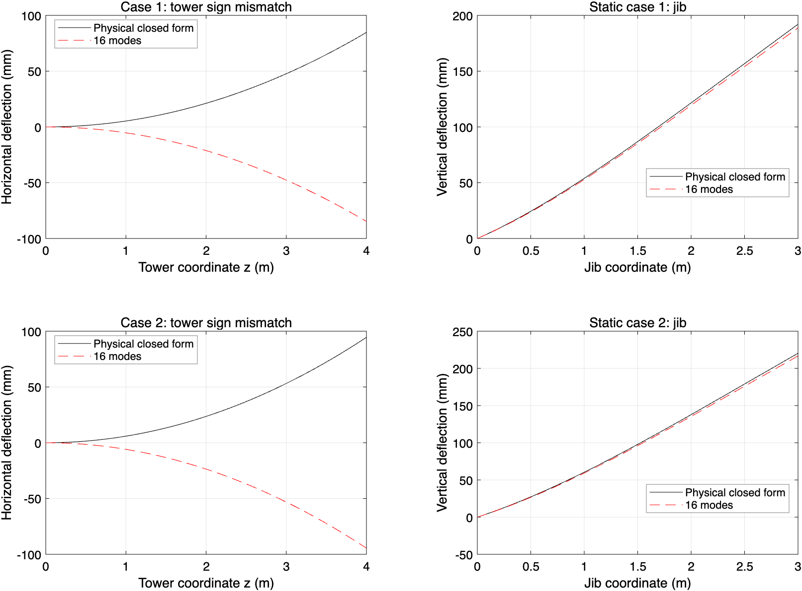
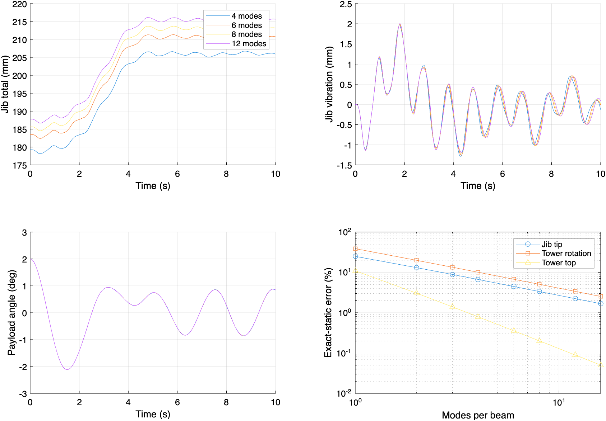

# 结构模态截断收敛与独立静挠度验证

验证日期：2026-11-02。对应 `matlab/validate_continuum_structure.m`。原有 3/4 阶研究保留在 `report/continuum/modal_convergence/`。本次输出单独存放，默认仿真参数仍为每根梁两阶。

**重要结论：独立物理静态/刚接运动学核查未通过。现有程序把塔顶斜率与臂根斜率设成反号，违背声明的坐标系下的刚接条件。下面的模态收敛数据描述现有方程的离散行为，不表示原物理模型已经验证正确。**

## 1. 验证范围与判据

两项验证均针对现有二维、底座固支、线性结构运动学模型。这里的解析解用于检验该数学模型的空间离散误差，不等同于真实塔吊实验验证。
动态分析固定绳网格为六段，结构分别使用 4、6、8、12 阶，覆盖 0–10 s，包括 1–5 s 小车运动、2–8 s 收绳和 8–10 s 停止后的残余响应。相对容差 2e-8、绝对容差 1e-10、最大步长 0.01 s，保存 2001 个时刻。只改变结构模态数，初始静挠度按各自模态空间计算；因此总位移差异中包含静态柔度误差。

动态相邻两组用最大时程差除以细阶模型的最大绝对响应（peak-norm），避免零交叉处逐点相除。辅助输出 L2 比例和 8–10 s 最大差。总位移、摆角、连接反力及小车驱动力采用 1% 比较阈值；扣除瞬时静挠度后的振动采用 5%。这些是本算例的工作判据，不是行业标准，也不证明无限阶极限已达到。静态对照以 1% 作为误差报告阈值。

## 2. 独立静态解析解

将小车固定于 a，绳长固定为 L，吊索垂直、全部速度为零。记 w=μJ g，P=(mT+mP+ρAL)g，传至塔顶的弯矩幅值 M=wB²/2+Pa。静态基准直接积分 Euler–Bernoulli 梁方程，不调用模态函数、模态质量或刚度矩阵。

按物理刚接和已声明的坐标，塔身满足 EI_T d⁴u/dz⁴=0、u(0)=u′(0)=0、EI_T u″(H)=M、EI_T u‴(H)=0，得到：

```text
u(z) = M z²/(2 EI_T)
u(H) = M H²/(2 EI_T)
u′(H) = M H/EI_T
```

吊臂相对根部的挠度由均布自重与点载荷叠加：

```text
v_w(ξ) = w ξ²(6B² − 4Bξ + ξ²)/(24 EI_J)
v_P(ξ) = P ξ²(3a − ξ)/(6 EI_J),  0 ≤ ξ ≤ a
v_P(ξ) = P a²(3ξ − a)/(6 EI_J),  a < ξ ≤ B
v_abs(ξ) = ξ u′(H) + v_w(ξ) + v_P(ξ)
```

该解满足根部相对位移/转角为零、臂端弯矩/剪力为零及点载荷处剪力跳跃。臂端绝对挠度必须包含 B u′(H)；只比较吊臂相对挠度会掩盖塔顶转角的截断误差。忽略了本模型未包含的轴压几何刚度、塔身轴向压缩、基础柔性和平衡臂。

检验两个静态工况：① a=2 m、L=2 m；② a=2.4 m、L=1.4 m。沿两根梁各取 501 个点比较全场，并分别记录塔顶位移、塔顶转角、臂端总位移和臂架相对挠度误差。第二工况是末端输入对应的独立静平衡，不是把动态仿真 t=10 s 当作静态解。

### 现有程序等效符号下的参考值（用于分离截断误差）

现有程序采用 v_abs=−ξu′+v_rel，导致其重力加载下塔身静挠度及转角均为上述物理解的反号，而臂端总挠度幅值公式相同。下面两表沿用程序等效符号参考；全场图则使用真正的物理静态基准，以分离模态截断误差；它们不是物理方向核查通过的证据。

| 量 | 程序等效参考值 |
|---|---:|
| 塔顶横移 / m | -0.084758400 |
| 塔顶转角 / rad | -0.042379200 |
| 臂端总挠度 / m | 0.192079800 |

### 模态截断误差

| 工况 | 每根梁模态数 | 塔顶位移误差 % | 塔顶转角误差 % | 臂端总挠度误差 % | 臂相对挠度全场最大误差 mm |
|---|---:|---:|---:|---:|---:|
| 1 | 1 | 10.92283 | 38.69239 | 24.94746 | 1.273541 |
| 1 | 2 | 3.04543 | 19.86235 | 13.08445 | 0.119945 |
| 1 | 3 | 1.39592 | 13.38913 | 8.86342 | 0.017770 |
| 1 | 4 | 0.79412 | 10.08044 | 6.68155 | 0.017873 |
| 1 | 6 | 0.35590 | 6.73926 | 4.46011 | 0.002630 |
| 1 | 8 | 0.20079 | 5.05950 | 3.34848 | 0.001637 |
| 1 | 12 | 0.08943 | 3.37542 | 2.23412 | 0.000379 |
| 1 | 16 | 0.05034 | 2.53221 | 1.67612 | 0.000195 |
| 2 | 1 | 10.92283 | 38.69239 | 24.72601 | 0.370334 |
| 2 | 2 | 3.04543 | 19.86235 | 12.72484 | 0.119638 |
| 2 | 3 | 1.39592 | 13.38913 | 8.58901 | 0.055862 |
| 2 | 4 | 0.79412 | 10.08044 | 6.48037 | 0.011531 |
| 2 | 6 | 0.35590 | 6.73926 | 4.33771 | 0.003905 |
| 2 | 8 | 0.20079 | 5.05950 | 3.25599 | 0.001914 |
| 2 | 12 | 0.08943 | 3.37542 | 2.17150 | 0.000496 |
| 2 | 16 | 0.05034 | 2.53221 | 1.62924 | 0.000172 |

从 4→8 和 8→16 阶的误差比估计，塔顶位移约为二阶收敛，塔顶转角和臂端总挠度约为一阶收敛，具体数值见 `static_convergence_rates.csv`。这是所测区间的经验阶次，不能外推为任意工况的严格误差界。

16 阶时，两个工况的塔顶位移幅值相对程序等效参考达到 1% 误差目标；塔顶转角和臂端总挠度仍未达到。初始工况的臂端误差主要来自塔顶转角，而不是臂架自身弯曲。未加载悬臂振型均满足自由端零弯矩，用它们逼近塔顶非零端弯矩载荷的边界响应，收敛较慢。此处检查的是位移与转角，不能据此宣称应力收敛。



## 3. 完整动态工况的模态收敛（现有方程）

振动量定义为 u_dynamic(t)−u_static,n(x(t),L(t))，其中静态量使用同一模态数 n。它用来分离静挠度偏差，但并不消除高阶模态缺失对动力学的影响。支承力是约束乘子 λ1:2，小车驱动力为 −λ5。所有误差均限于保存的时刻；本次不额外宣称高频峰值已采样收敛。

| 量 | 模态比较 | 最大绝对差（SI） | peak-norm 差 % | L2 差 % | 工作阈值 % | 达标 |
|---|---|---:|---:|---:|---:|---|
| tower_total | 4→6 | 0.000541397 | 0.57206 | 0.44259 | 1 | 是 |
| jib_total | 4→6 | 0.00491804 | 2.32544 | 2.26156 | 1 | 否 |
| tower_vibration | 4→6 | 0.000127255 | 7.88020 | 9.18887 | 5 | 否 |
| jib_vibration | 4→6 | 0.000198253 | 10.01541 | 12.11743 | 5 | 否 |
| payload_angle | 4→6 | 0.000105711 | 0.28593 | 0.24787 | 1 | 是 |
| support_x | 4→6 | 0.00474476 | 0.25310 | 0.22997 | 1 | 是 |
| support_y | 4→6 | 0.0838438 | 0.16234 | 0.07244 | 1 | 是 |
| trolley_drive | 4→6 | 0.63462 | 2.76225 | 2.10788 | 1 | 否 |
| tower_total | 6→8 | 0.000204288 | 0.21552 | 0.15697 | 1 | 是 |
| jib_total | 6→8 | 0.00247957 | 1.15942 | 1.12664 | 1 | 否 |
| tower_vibration | 6→8 | 5.84942e-05 | 3.65565 | 4.42276 | 5 | 是 |
| jib_vibration | 6→8 | 0.000103495 | 5.19190 | 6.03795 | 5 | 否 |
| payload_angle | 6→8 | 4.3944e-05 | 0.11884 | 0.11751 | 1 | 是 |
| support_x | 6→8 | 0.00218261 | 0.11639 | 0.10950 | 1 | 是 |
| support_y | 6→8 | 0.0410622 | 0.07949 | 0.03818 | 1 | 是 |
| trolley_drive | 6→8 | 0.311924 | 1.34500 | 1.04483 | 1 | 否 |
| tower_total | 8→12 | 0.000159606 | 0.16816 | 0.11360 | 1 | 是 |
| jib_total | 8→12 | 0.00248692 | 1.15011 | 1.11638 | 1 | 否 |
| tower_vibration | 8→12 | 5.84931e-05 | 3.69108 | 4.34634 | 5 | 是 |
| jib_vibration | 8→12 | 9.74522e-05 | 4.85961 | 6.03368 | 5 | 是 |
| payload_angle | 8→12 | 4.81024e-05 | 0.13007 | 0.11413 | 1 | 是 |
| support_x | 8→12 | 0.00222235 | 0.11846 | 0.10632 | 1 | 是 |
| support_y | 8→12 | 0.0388452 | 0.07520 | 0.03955 | 1 | 是 |
| trolley_drive | 8→12 | 0.322745 | 1.37961 | 1.05199 | 1 | 否 |

最后一组 8→12 阶比较中，6/8 项满足工作判据。未达标项：jib_total、trolley_drive。



## 4. 实现与数值可靠性

原程序仅支持 1–4 阶，已扩展到 1–16 阶。高阶振型中的双曲函数相减改用稳定的指数组合，避免 cosh 与 sinh 大数抵消；连续积分点数取 max(32,4nT,4nJ)。旧 1–4 阶表达式与稳定表达式在位移、一阶导数、二阶导数上的最大差为 2.107e-11。另用 96 点独立积分检查 16 阶模态正交性、解析模态质量 L/4、解析模态刚度 β⁴/(4L³) 和固支边界，记录见 `high_modes_validation.txt`。

每个动态工况检查位置约束 <1e-7 m、速度约束 <1e-6 m/s，以及全程保存的最小轴力为正。稳定公式与既有四阶完整动态结果的回归误差为：摆角 9.972e-13 rad、塔顶位移 3.221e-13 m、臂端位移 5.996e-13 m，见 `low_mode_regression.txt`。原有验证已检查时间积分容差与绳网格敏感性，本次聚焦结构模态截断；高阶模型本身没有额外独立的时间步/绳网格双重加密，因此结果应按指定离散与积分设置理解。

## 5. 独立刚接方向核查：未通过

塔身从下至上的切向量为 [u′(H),−1]；刚接且初始正交的臂根切向量在线性精度下应为 [1,u′(H)]，两者内积为零。当前代码却给出 [1,−u′(H)]，内积为 2u′(H)，是一阶误差，不能用微小转角近似解释。`audit_continuum_connection.m` 通过对 `continuum.point` 的吊点位置做中心差分取得臂根方向，而不是直接抄写预期答案。

初始工况物理解要求塔顶向右位移 +0.0847584 m。程序随模态加密趋向 −0.0847584 m，故有符号误差趋向 200%。这说明能量守恒、约束残差很小和空间离散收敛仍不足以证明连接运动学正确。两个静态工况的完整有符号误差见 `physical_static_validation.csv`；几何核查详细数值见 `connection_sign_audit.csv` 和 `connection_sign_audit.txt`。

应统一修正 `point.m` 的臂根转角、相应雅可比和对流加速度，`setup.m` 的臂架绝对运动学，以及 `assemble.m` / `plot_results.m` 中的臂端位置；随后重新生成静态和动态验证。仅改变报告里的正负号不能修复动力学耦合。本次保留被验证模型的物理方程，以避免将修正前后的数据混为一组。

## 6. 结论与复现

独立核查首先暴露了上述连接方向错误，修正前不应将该模型用于物理预测。数值验证已经完成，但“完成验证”不等于“所有量已收敛”。总位移、局部振动与反力应按各自判据分别报告，不能用吊载摆角差小代替结构收敛结论。特别是静态臂端挠度，即便 16 阶仍有约 1.6–1.7% 的解析误差，当前纯未加载悬臂模态对塔顶端弯矩的响应效率较低。在修正刚接符号并重跑后，若要求严格的 1% 结构挠度精度，优先考虑加入端弯矩静态修正形函数或采用适合连接载荷的 Ritz 基，并重新验证动力学。本次没有加入修正基或更改默认两阶参数。

```matlab
addpath('matlab');
test_continuum_high_modes;
result=validate_continuum_structure;
plot_continuum_static_validation;
audit_continuum_connection;
```

主验证会缓存每个模态数的 MAT 结果；复跑会核对参数后复用。修改求解器或模型实现后，应换输出目录或移走相应缓存再运行。全部结果位于 `report/continuum/structure_validation/`，不覆盖旧 3/4 阶研究。
