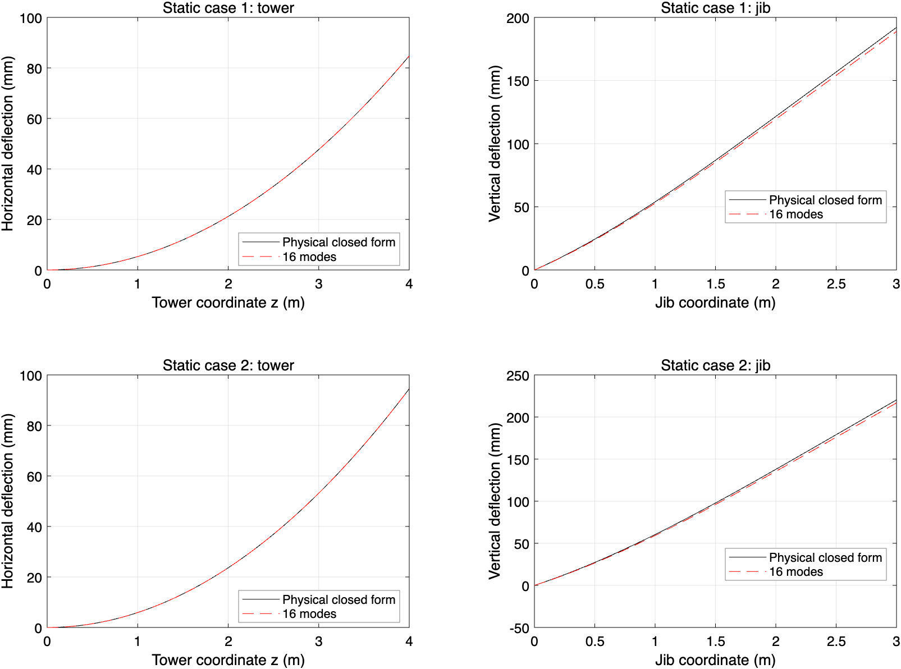
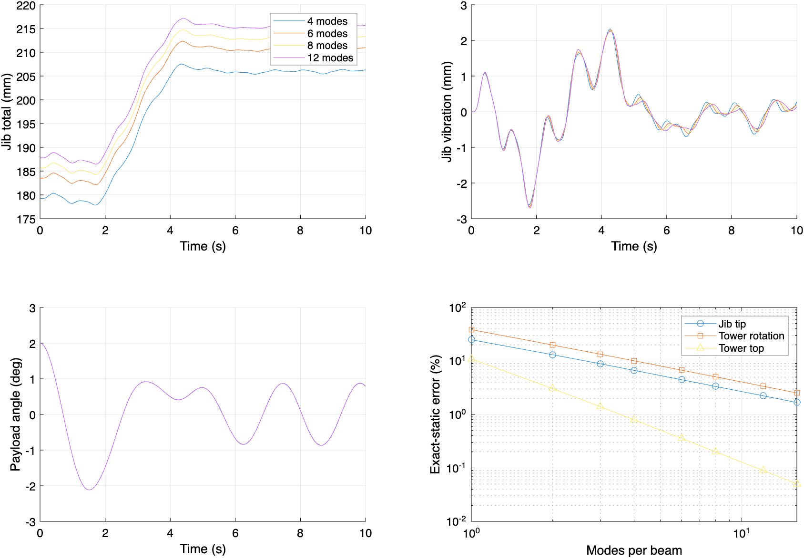

# 刚接符号修正与重新验证

日期：2026-11-02。所有动态结果均从修正后的方程重新积分，未将修正前时程取反后充当新结果。旧研究保存在 `../structure_validation/`，旧默认算例及说明书保存在 `../legacy_before_sign_fix/`。

## 1. 修正内容与物理依据

坐标 X 向右、Y 向下，塔身 z 从底座向上。塔顶切线为 [wT′(H),−1]，与其刚接的臂根切线应为 [1,wT′(H)]，故臂架绝对竖向位移必须是 **+ξ bη+ψ(ξ)ζ**。旧负号已统一改正。

```text
rA,Y = x bη + ψ(x)ζ
JA,Y = [x b, ψ(x), bη + ψ′(x)ζ]
hA,Y = 2[bη̇ + ψ′(x)ζ̇]ẋ + ψ″(x)ζ ẋ²
```

修正覆盖 `point.m` 的位置、雅可比和对流加速度，`setup.m` 的臂架分布惯性与重力，`assemble.m` 的臂端输出，以及 `plot_results.m` 的几何绘制。静态初值、约束矩阵和能量通过上述运动学自动一致更新。旧 3/4 阶分析入口也已修正并使用新输出目录。默认模态数仍为两阶，没有用增加刚度或调整荷载抵消符号错误。

## 2. 独立刚接与静态验证

通过对 `continuum.point` 的位置作中心差分获取臂根切线，与塔顶切线进行正交性检查。该检查独立于预期的解析雅可比。

| 模态数 | 塔顶位移 m | 解析位移 m | 有符号相对误差 % | 两切线归一化内积 |
|---:|---:|---:|---:|---:|
| 2 | 0.082177140 | 0.084758400 | 3.045433 | 2.306e-13 |
| 4 | 0.084085316 | 0.084758400 | 0.794120 | 2.053e-13 |
| 8 | 0.084588212 | 0.084758400 | 0.200792 | 2.254e-13 |
| 12 | 0.084682598 | 0.084758400 | 0.089433 | 2.146e-13 |
| 16 | 0.084715729 | 0.084758400 | 0.050344 | 2.183e-13 |

塔身现在向右挠曲，与独立物理解一致。切线内积约为 2e-13，刚接方向检查通过。有限阶幅值误差仍须单独评价。

静态基准直接积分连续梁方程，不使用模态矩阵。令 a 为固定小车坐标，P=(mT+mP+ρAL)g，w=μJg，M=wB²/2+Pa：

```text
u(z) = Mz²/(2 EI_T)
u′(H) = MH/EI_T
v_w(ξ) = wξ²(6B²−4Bξ+ξ²)/(24 EI_J)
v_P(ξ) = Pξ²(3a−ξ)/(6 EI_J),  ξ≤a
v_P(ξ) = Pa²(3ξ−a)/(6 EI_J),  ξ>a
v_abs(ξ) = ξu′(H)+v_w(ξ)+v_P(ξ)
```

工况 1：a=2 m、L=2 m；工况 2：a=2.4 m、L=1.4 m。两根梁各使用 501 个空间点检查全场。工况 2 是独立静平衡，不是把 t=10 s 的动态位置当作静态解。

| 工况 | 模态数 | 塔顶位移误差 % | 塔顶转角误差 % | 臂端总挠度误差 % | 臂相对挠度全场误差 mm |
|---|---:|---:|---:|---:|---:|
| 1 | 1 | 10.92283 | 38.69239 | 24.94746 | 1.273541 |
| 1 | 2 | 3.04543 | 19.86235 | 13.08445 | 0.119945 |
| 1 | 3 | 1.39592 | 13.38913 | 8.86342 | 0.017770 |
| 1 | 4 | 0.79412 | 10.08044 | 6.68155 | 0.017873 |
| 1 | 6 | 0.35590 | 6.73926 | 4.46011 | 0.002630 |
| 1 | 8 | 0.20079 | 5.05950 | 3.34848 | 0.001637 |
| 1 | 12 | 0.08943 | 3.37542 | 2.23412 | 0.000379 |
| 1 | 16 | 0.05034 | 2.53221 | 1.67612 | 0.000195 |
| 2 | 1 | 10.92283 | 38.69239 | 24.72601 | 0.370334 |
| 2 | 2 | 3.04543 | 19.86235 | 12.72484 | 0.119638 |
| 2 | 3 | 1.39592 | 13.38913 | 8.58901 | 0.055862 |
| 2 | 4 | 0.79412 | 10.08044 | 6.48037 | 0.011531 |
| 2 | 6 | 0.35590 | 6.73926 | 4.33771 | 0.003905 |
| 2 | 8 | 0.20079 | 5.05950 | 3.25599 | 0.001914 |
| 2 | 12 | 0.08943 | 3.37542 | 2.17150 | 0.000496 |
| 2 | 16 | 0.05034 | 2.53221 | 1.62924 | 0.000172 |

符号修正消除了方向错误，但没有消除基函数截断误差。16 阶时塔顶位移误差约 0.050%，塔顶转角误差约 2.532%，臂端总挠度误差仍约 1.63–1.68%。按 1% 工作目标，后两项尚未达标。塔顶位移约二阶收敛，转角和臂端总挠度约一阶收敛；经验阶次见 `static_convergence_rates.csv`。



## 3. 动态模态截断验证

固定六段绳，比较每根梁 4、6、8、12 阶；时间 0–10 s，RelTol=2e-8、AbsTol=1e-10、MaxStep=0.01 s，保存 2001 个时刻。比较原始总位移、相对各阶瞬时静平衡的振动、吊载弦线摆角、吊点反力和小车驱动力。另输出 8–10 s 停机后的最大差。

最大时程差除以细阶模型的峰值绝对响应，得到 peak-norm 误差；不用逐点相除。总位移、摆角、反力和驱动力采用 1% 工作阈值，分离的振动采用 5%。L2 误差同时提供，未作为本次通过判据。这些是算例工作阈值，不是行业标准。

| 量 | 模态比较 | 最大差（SI） | peak-norm % | L2 % | 阈值 % | 达标 |
|---|---|---:|---:|---:|---:|---|
| tower_total | 4→6 | 0.000515716 | 0.54020 | 0.44224 | 1 | 是 |
| jib_total | 4→6 | 0.00490121 | 2.30855 | 2.26243 | 1 | 否 |
| tower_vibration | 4→6 | 0.0001088 | 5.53340 | 6.34153 | 5 | 否 |
| jib_vibration | 4→6 | 0.00018024 | 6.76888 | 7.88223 | 5 | 否 |
| payload_angle | 4→6 | 9.94712e-05 | 0.26915 | 0.20501 | 1 | 是 |
| support_x | 4→6 | 0.00439934 | 0.23381 | 0.19133 | 1 | 是 |
| support_y | 4→6 | 0.0889098 | 0.17205 | 0.08599 | 1 | 是 |
| trolley_drive | 4→6 | 0.621537 | 2.63199 | 2.08633 | 1 | 否 |
| tower_total | 6→8 | 0.000199431 | 0.20853 | 0.15749 | 1 | 是 |
| jib_total | 6→8 | 0.00247396 | 1.15224 | 1.12689 | 1 | 否 |
| tower_vibration | 6→8 | 5.2844e-05 | 2.70399 | 3.13544 | 5 | 是 |
| jib_vibration | 6→8 | 9.05738e-05 | 3.37435 | 4.03371 | 5 | 是 |
| payload_angle | 6→8 | 4.49187e-05 | 0.12153 | 0.09947 | 1 | 是 |
| support_x | 6→8 | 0.00214585 | 0.11407 | 0.09182 | 1 | 是 |
| support_y | 6→8 | 0.0439351 | 0.08501 | 0.04582 | 1 | 是 |
| trolley_drive | 6→8 | 0.312661 | 1.31190 | 1.03221 | 1 | 否 |
| tower_total | 8→12 | 0.000156548 | 0.16347 | 0.11427 | 1 | 是 |
| jib_total | 8→12 | 0.00247378 | 1.13946 | 1.11660 | 1 | 否 |
| tower_vibration | 8→12 | 5.13079e-05 | 2.63969 | 3.08459 | 5 | 是 |
| jib_vibration | 8→12 | 8.70131e-05 | 3.22002 | 4.02332 | 5 | 是 |
| payload_angle | 8→12 | 4.27826e-05 | 0.11573 | 0.09667 | 1 | 是 |
| support_x | 8→12 | 0.00211918 | 0.11268 | 0.08888 | 1 | 是 |
| support_y | 8→12 | 0.0452824 | 0.08763 | 0.04605 | 1 | 是 |
| trolley_drive | 8→12 | 0.312059 | 1.29872 | 1.03601 | 1 | 否 |

8→12 阶时，6/8 项满足判据。未达标项：jib_total、trolley_drive。



## 4. 回归测试

完整回归重新检查静平衡、质量矩阵对称正定、约束独立性、孤立梁频率、移动吊点速度/对流加速度、加载平衡点切线对称性与频率正值、固定域能量、收绳张力/约束、时间容差和绳 3/6 单元及梁 2/3 模态敏感性。结果如下：

```text
Continuous-beam / ANCF validation 20261102T021434
PASS static acceleration 4.658e-09, SPD mass, independent constraints
PASS isolated tower first frequency 2.85565194 Hz
PASS moving attachment velocity and convective acceleration
Coupled first six frequencies (Hz): 0.3518812 1.0669485 2.7683818 5.6120074 7.5514795 11.2098846
PASS fixed-domain energy drift 9.905e-12 J; constraint 5.596e-14 m
PASS trolley + hoist: min axial 48.70281 N, constraint 6.199e-12 m, dynamics 2.842e-14
Running tighter time tolerances...
Running six rope elements...
Running three modes per beam...
PASS angle sensitivity: time 1.976e-11 rad; rope 3/6 4.914e-08 rad; modes 2/3 1.060e-04 rad
Tower displacement mode sensitivity 1.731e-03 m; jib tip 9.391e-03 m
ALL CHECKS PASSED. Sensitivity checks do not establish local stress convergence.
```

16 阶稳定振型的独立正交积分测试也通过；其解析质量、刚度积分误差约为 8e-15。能量守恒和小约束残差只证明相应数值性质，不能替代静态独立解析解和刚接几何检查。

## 5. 修正后的默认算例

默认两阶/三段绳的 10 s 仿真重新运行。最大弦线摆角 2.116461°；采样最小轴力 48.470858 N；最大位置约束误差 6.199e-12 m。塔顶位移范围 0.08063531 至 0.09289124 m，臂端位移范围 0.16554471 至 0.19346681 m。位移包含重力静挠度。

## 6. 适用结论与复现

刚接符号和方向错误已修复，独立几何、静平衡与数值回归通过。结构模态误差仍需按量报告，不能表述为所有量已经收敛到 1%。若需要更高的结构转角/臂端挠度精度，下一步应考虑端弯矩静态修正形函数或适合连接荷载的 Ritz 基，而不只是提高积分精度。

误差针对已保存时刻；未单独验证高频反力峰值的采样收敛，未对所有高阶模型重新进行时间步和绳网格联合加密。没有新增基础柔性、轴压几何刚度或实机参数识别；本次不构成实验验证。

```matlab
addpath('matlab');
audit_continuum_connection;
test_continuum_high_modes;
test_continuum_ancf;
result=validate_continuum_structure;
plot_continuum_static_validation;
out=tower_crane_continuum_ancf;
```

本目录独立保存新结果。动态缓存核对参数及 point/setup/assemble/modes/rhs/simulate/initial_state 源文件内容。该检查不覆盖所有间接依赖；更改绳单元、输入函数、模型或求解器后，请换目录或移走旧缓存再运行。
